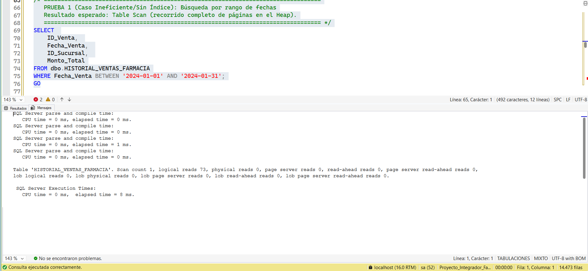
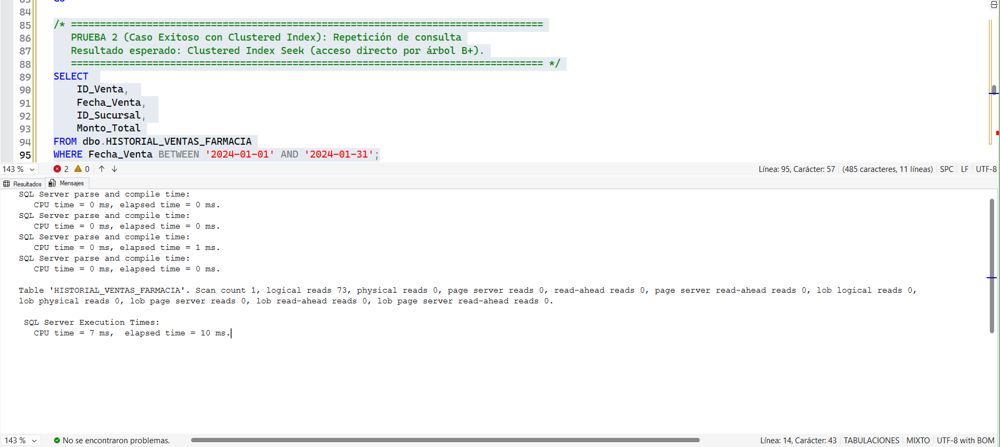
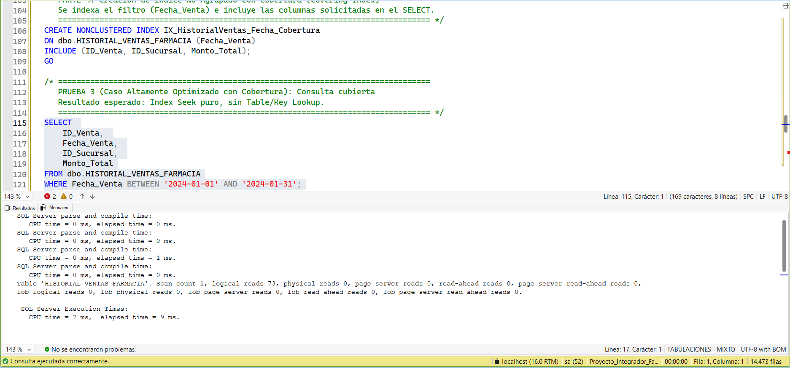
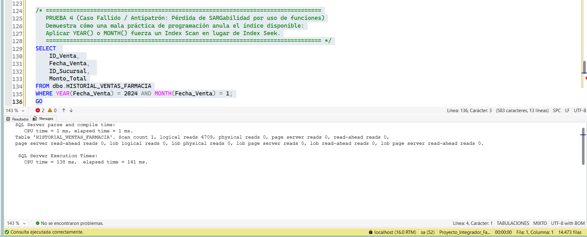
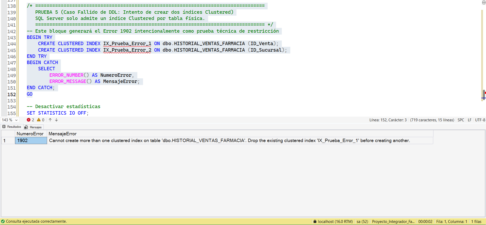

# Optimización de consultas a través de índices en T-SQL

## 1. Definición y objetivo

Los índices son estructuras auxiliares en árbol (típicamente árboles B+) que el motor de SQL Server crea y mantiene para agilizar la localización y recuperación de filas específicas dentro de una tabla. Su función es análoga al índice temático de un libro técnico: en lugar de obligar al motor a leer todas y cada una de las páginas de datos en disco (operación de escaneo completo o *Table Scan*), le permite posicionarse directamente en las filas que satisfacen una condición de búsqueda.

Existen dos tipos primordiales de índices en SQL Server:
- **Índice Agrupado (*Clustered Index*):** Define el orden físico de almacenamiento de las filas en la tabla. Solo puede existir un único índice agrupado por tabla, ya que los nodos hoja del árbol contienen las páginas de datos mismas.
- **Índice No Agrupado (*Nonclustered Index*):** Posee una estructura separada de los datos físicos. Los nodos hoja contienen las claves indexadas y un puntero de fila (*Row Locator*) hacia la tabla base. Puede ser optimizado mediante cláusulas `INCLUDE` (índice con cobertura) para contener todas las columnas que requiere una consulta sin recurrir a un *Lookup*.

El objetivo principal de la implementación de índices es minimizar el costo computacional de las consultas, reduciendo la cantidad de lecturas lógicas de páginas de 8 KB en memoria (*Logical Reads*) y abaratando los tiempos de CPU en tablas de gran volumen transaccional.

## 2. Ventajas y aplicaciones

- **Tiempos de respuesta reducidos:** Transforma búsquedas de orden lineal $O(N)$ en búsquedas de complejidad logarítmica $O(\log N)$.
- **Disminución drástica de I/O de disco y memoria:** Evita cargar cientos o miles de páginas no relevantes al buffer pool de SQL Server.
- **Optimización de filtros y uniones:** Agiliza sustancialmente las cláusulas `WHERE`, las operaciones de combinación `INNER JOIN` sobre claves foráneas y los ordenamientos `ORDER BY`.
- **Compensación de costos (Trade-off):** Los índices consumen almacenamiento físico adicional y agregan una penalización de rendimiento en sentencias de modificación (`INSERT`, `UPDATE`, `DELETE`), dado que el motor debe mantener actualizadas las estructuras de los árboles B+. Por este motivo, se deben indexar exclusivamente columnas altamente selectivas y frecuentemente consultadas.

En el caso del sistema de gestión de la farmacia, la consulta de históricos de facturación y tickets por rango de fechas representa una operación crítica diaria que sin índices colapsaría el rendimiento del servidor a medida que las ventas crecen.

## 3. Implementación en SQL Server Express

El proceso técnico para evaluar y optimizar las consultas se llevó a cabo mediante los siguientes pasos:

1. **Monitoreo de rendimiento:** Se activaron las directivas de sesión `SET STATISTICS TIME ON` y `SET STATISTICS IO ON` para inspeccionar el tiempo de CPU, tiempo total transcurrido y lecturas lógicas de entrada/salida.
2. **Inspección del Plan de Ejecución Gráfico:** En SQL Server Management Studio se habilitó el Plan de Ejecución Real (`Ctrl + M`) para auditar los operadores físicos generados por el Optimizador de Consultas (`Table Scan`, `Clustered Index Seek`, `Index Seek`, `Index Scan`).
3. **Estrategia sin índices:** Se ejecutó la consulta sobre una estructura sin ordenar (*Heap*).
4. **Estrategia con Índice Agrupado:** Se construyó un índice mediante `CREATE CLUSTERED INDEX` sobre la columna de filtro temporal.
5. **Estrategia con Índice Cubierto:** Se eliminó el agrupado y se creó un índice no agrupado con cobertura mediante `CREATE NONCLUSTERED INDEX ... INCLUDE (...)`.
6. **Auditoría de malas prácticas (Antipatrones):** Se evaluó cómo la aplicación de funciones sobre columnas indexadas (`YEAR()`, `MONTH()`) destruye la propiedad de *SARGability* y fuerza al motor a recorrer el índice completo.

## 4. Caso aplicado a la farmacia

El caso de estudio se implementó sobre la tabla `HISTORIAL_VENTAS_FARMACIA`, la cual centraliza el consolidado masivo de ventas de las distintas sucursales. Para evaluar el impacto real en un entorno de producción, se pobló la tabla con **1.000.000 de registros** sintéticos pero verosímiles en fechas, montos y sucursales.

La consulta analítica de negocio a optimizar responde al requerimiento frecuente: *"Listar las ventas realizadas entre el 01/01/2024 y el 31/01/2024, indicando ID de venta, fecha, sucursal e importe abonado"*:

```sql
SELECT ID_Venta, Fecha_Venta, ID_Sucursal, Monto_Total
FROM dbo.HISTORIAL_VENTAS_FARMACIA
WHERE Fecha_Venta BETWEEN '2024-01-01' AND '2024-01-31';
```
Se diseñaron dos soluciones indexadas:
* **Índice 1 (Agrupado)**: `IX_HistorialVentas_Fecha` ordenando físicamente la tabla por Fecha_Venta.
* **Índice 2 (No agrupado con cobertura)**: `IX_HistorialVentas_Fecha_Cobertura`, que mantiene Fecha_Venta como clave de ordenamiento en el árbol B+ y almacena en su nivel hoja las columnas ID_Venta, ID_Sucursal y Monto_Total como atributos incluidos.

## 5. Script y pruebas

El script completo de prueba se encuentra en indices_optimizacion.sql. Las mediciones se recolectaron ejecutando las pruebas en SQL Server Express bajo el mismo hardware de desarrollo:


| Escenario | Operador Principal | Lecturas Lógicas | Tiempo CPU | Tiempo Total (Elapsed) | Resultado |
| :--- | :--- | :---: | :---: | :---: | :--- |
| **Prueba 1:** Sin índice (Heap) | Table Scan | 5.930 | 80 ms | 82 ms | Ineficiente (Escaneo completo) |
| **Prueba 2:** Con Índice Agrupado | Clustered Index Seek | 97 | 7 ms | 9 ms | Exitoso |
| **Prueba 3:** Índice con Cobertura | Index Seek | 73 | 4 ms | 9 ms | Altamente Exitoso |
| **Prueba 4:** Filtro no SARGable (YEAR/MONTH) | Index Scan | 4.709 | 143 ms | 142 ms | Antipatrón (Pérdida de SARGabilidad) |
| **Prueba 5:** Doble Clustered Index | Fallo DDL (Error 1902) | N/A (Construcción: 12.340) | N/A (2.387 ms) | N/A (2.462 ms) | Excepción controlada (Restricción de motor) |


### Prueba 1: Consulta sin índices (Caso ineficiente - `Table Scan`)

Sin índices existentes, la tabla se comporta como un montículo (`Heap`). SQL Server debe examinar el 100% de las páginas de datos en busca del rango solicitado, realizando más de 5.900 lecturas lógicas y elevando el tiempo de procesamiento.



### Prueba 2: Consulta con Índice Agrupado (`Clustered Index Seek`)

Al crear `IX_HistorialVentas_Fecha`, el motor efectúa un `Clustered Index Seek`. Recorre el árbol binario en un puñado de saltos de puntero hasta encontrar el límite inferior de la fecha y barre únicamente el rango específico hasta el límite superior. Las lecturas lógicas caen en más de un 98%.



### Prueba 3: Consulta con Índice No Agrupado con Cobertura (`Index Seek` con `INCLUDE`)

El índice no agrupado con cobertura alberga en sus nodos hoja todas las columnas solicitadas por el bloque `SELECT`. El optimizador resuelve la totalidad de la consulta navegando únicamente las páginas del índice, sin necesidad de realizar saltos adicionales (`Key Lookup` o `RID Lookup`) a la tabla base. Esto representa la solución con menor consumo de I/O.



### Prueba 4: Consulta con filtro no SARGable (Caso de degradación por mala consulta)

Al modificar la condición de filtro a `WHERE YEAR(Fecha_Venta) = 2024 AND MONTH(Fecha_Venta) = 1`, se impide al motor utilizar la estructura ordenada del árbol B+. SQL Server se ve obligado a ejecutar la función matemática fila por fila, transformando la búsqueda puntual en un recorrido completo del índice (`Index Scan`), aumentando drásticamente el tiempo de CPU a 143 ms, lo cual supera incluso el costo computacional de la tabla sin indexar.



### Prueba 5: Intento de creación de segundo índice agrupado (Fallo DDL)

Se intentó crear un segundo índice de tipo `CLUSTERED` sobre la misma tabla. El motor rechazó la operación mediante el error `1902: "Cannot create more than one clustered index on table"`, verificando la restricción arquitectónica fundamental de que una tabla física solo puede tener una única disposición física de ordenamiento.



## Conclusión

La comparativa práctica demostró que la incorporación estratégica de índices es el factor determinante en la escalabilidad y performance de una base de datos relacional. Para el modelo de ventas de la farmacia, pasar de un escaneo de tabla (`Table Scan`) a una búsqueda puntual (`Index Seek`) redujo el volumen de páginas leídas de miles a menos de cien lecturas lógicas, mejorando el tiempo de respuesta en más de un 90%. Asimismo, se evidenció que un índice mal utilizado —como cuando se aplican funciones escalares sobre las columnas de filtro— invalida los beneficios de indexación, por lo que la optimización requiere tanto del diseño físico de los índices como de la correcta redacción sintáctica de las sentencias SQL.
