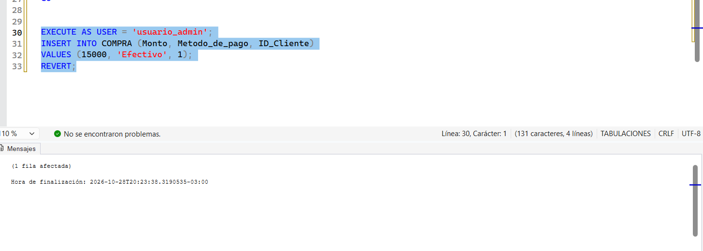
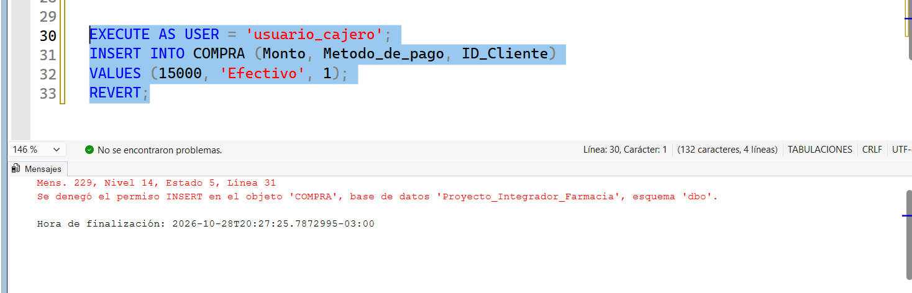
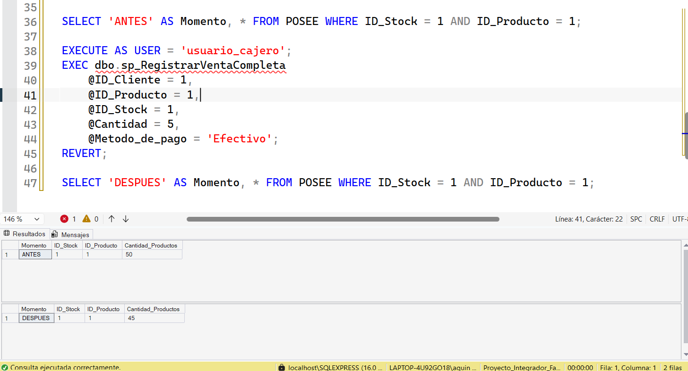
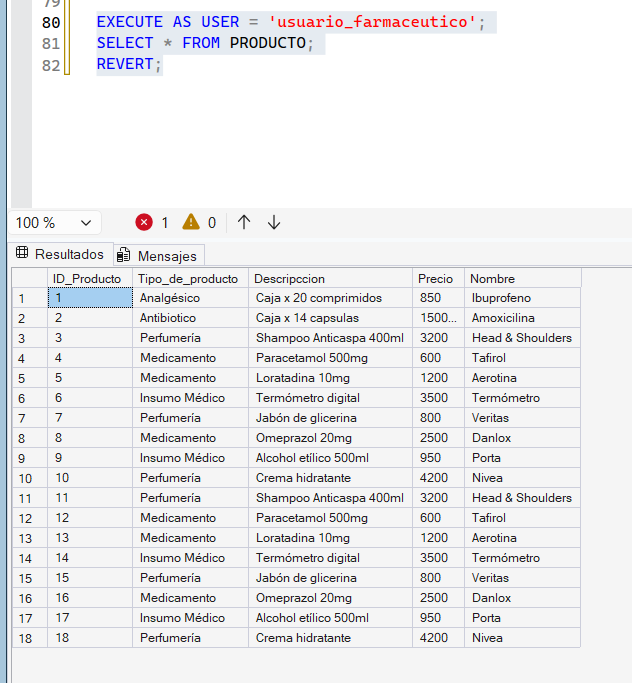
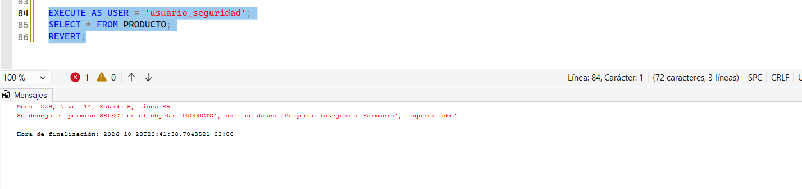

# Seguridad: permisos a nivel de usuarios y roles

Script: [`scripts.sql`](scripts.sql)

## 1. Definición y objetivo

La seguridad en una base de datos permite controlar qué usuarios pueden acceder a la información y qué operaciones pueden realizar. SQL Server permite manejar los permisos de forma individual (a cada usuario) o agrupándolos mediante roles.

El objetivo es aplicar el **principio de mínimo privilegio**: cada usuario tiene solo los permisos que necesita para su trabajo.

## 2. Ventajas y aplicaciones

- Protegen la información sensible del sistema.
- Evitan modificaciones accidentales o no autorizadas.
- Permiten asignar permisos según el puesto de cada empleado (cajero, farmacéutico, seguridad).
- Los roles simplifican la administración: si entra un farmacéutico nuevo, solo se lo agrega al rol.
- Mejoran la seguridad y el mantenimiento de la base de datos.

## 3. Implementación en SQL Server Express

Los pasos son:

1. Crear un inicio de sesión (`CREATE LOGIN`), que permite conectarse al servidor.
2. Crear un usuario en la base asociado a ese login (`CREATE USER ... FOR LOGIN`).
3. Dar permisos al usuario con `GRANT`, o crear un rol (`CREATE ROLE`), darle permisos al rol y agregar usuarios con `ALTER ROLE ... ADD MEMBER`.

Para las pruebas usamos `EXECUTE AS USER = '...'`, que ejecuta las sentencias como si fuéramos ese usuario, y `REVERT`, que vuelve a nuestro usuario. Así no hace falta desconectarse y entrar con cada login.

## 4. Caso concreto aplicado a la farmacia

Adaptamos el ejemplo de la guía a nuestro modelo:

| Usuario | Perfil | Permisos |
|---|---|---|
| `usuario_admin` | Administrador | Miembro de `db_owner` |
| `usuario_cajero` | Cajero | `SELECT` sobre `COMPRA` y `EXECUTE` sobre `sp_RegistrarVentaCompleta` |
| `usuario_farmaceutico` | Farmacéutico | Miembro de `rol_farmaceutico` (`SELECT` sobre `PRODUCTO`) |
| `usuario_seguridad` | Personal de seguridad | Sin permisos |

### Parte 1: permisos a nivel de usuarios

El cajero puede consultar las compras pero no puede insertar directamente en la tabla `COMPRA`. Sin embargo, sí puede registrar una venta usando el procedimiento `sp_RegistrarVentaCompleta`, que armamos en el tema de procedimientos y funciones.

De esta forma el cajero no puede cargar una compra "a mano", sino que siempre pasa por el procedimiento, que valida el stock, aplica el descuento y genera el ticket.

### Parte 2: permisos a nivel de roles

Creamos el rol `rol_farmaceutico` con permiso de lectura sobre `PRODUCTO` y agregamos al farmacéutico. El usuario de seguridad no pertenece al rol, por lo que no puede consultar los productos.

## 5. Script de demostración y resultados

El script completo está en [`scripts.sql`](scripts.sql). Las pruebas se ejecutaron en SQL Server Express 16 (`localhost\SQLEXPRESS`).

### Resumen de resultados

| Prueba | Usuario | Resultado esperado | Resultado obtenido |
|---|---|---|---|
| INSERT directo sobre `COMPRA` | `usuario_admin` | Correcto | ✅ Correcto (1 fila afectada) |
| INSERT directo sobre `COMPRA` | `usuario_cajero` | Acceso denegado | ✅ Denegado (Mens. 229) |
| EXEC `sp_RegistrarVentaCompleta` | `usuario_cajero` | Correcto | ✅ Correcto (stock 50 → 45) |
| SELECT sobre `PRODUCTO` | `usuario_farmaceutico` (con rol) | Correcto | ✅ Correcto (devuelve los productos) |
| SELECT sobre `PRODUCTO` | `usuario_seguridad` (sin rol) | Acceso denegado | ✅ Denegado (Mens. 229) |

### Parte 1: permisos a nivel de usuarios

**Prueba 1: INSERT directo con `usuario_admin`**

El administrador pertenece a `db_owner`, así que puede insertar sin problemas.



**Prueba 2: INSERT directo con `usuario_cajero`**

El cajero solo tiene permiso `SELECT` sobre `COMPRA`, por eso SQL Server rechaza el INSERT:

```
Mens. 229, Nivel 14, Estado 5
Se denegó el permiso INSERT en el objeto 'COMPRA', base de datos 'Proyecto_Integrador_Farmacia', esquema 'dbo'.
```



**Prueba 3: venta mediante `sp_RegistrarVentaCompleta` con `usuario_cajero`**

El mismo cajero que no pudo insertar en `COMPRA` sí puede registrar una venta de 5 unidades a través del procedimiento. Se ve que el stock del producto 1 en `POSEE` baja de 50 a 45, así que el procedimiento registró la compra, el ticket y el detalle, y descontó el stock.



### Parte 2: permisos a nivel de roles

**Prueba 4: SELECT sobre `PRODUCTO` con `usuario_farmaceutico` (con rol)**

El farmacéutico no tiene permisos propios, pero los hereda de `rol_farmaceutico`, así que la consulta devuelve los productos.



**Prueba 5: SELECT sobre `PRODUCTO` con `usuario_seguridad` (sin rol)**

El usuario de seguridad no pertenece al rol, así que no puede consultar:

```
Mens. 229, Nivel 14, Estado 5
Se denegó el permiso SELECT en el objeto 'PRODUCTO', base de datos 'Proyecto_Integrador_Farmacia', esquema 'dbo'.
```



### Conclusión

El cajero no puede modificar la tabla `COMPRA` directamente, pero sí puede registrar ventas a través del procedimiento almacenado. Así se mantiene el control de la lógica de negocio. Con los roles, los permisos se asignan una sola vez al rol y todos sus miembros los heredan.

